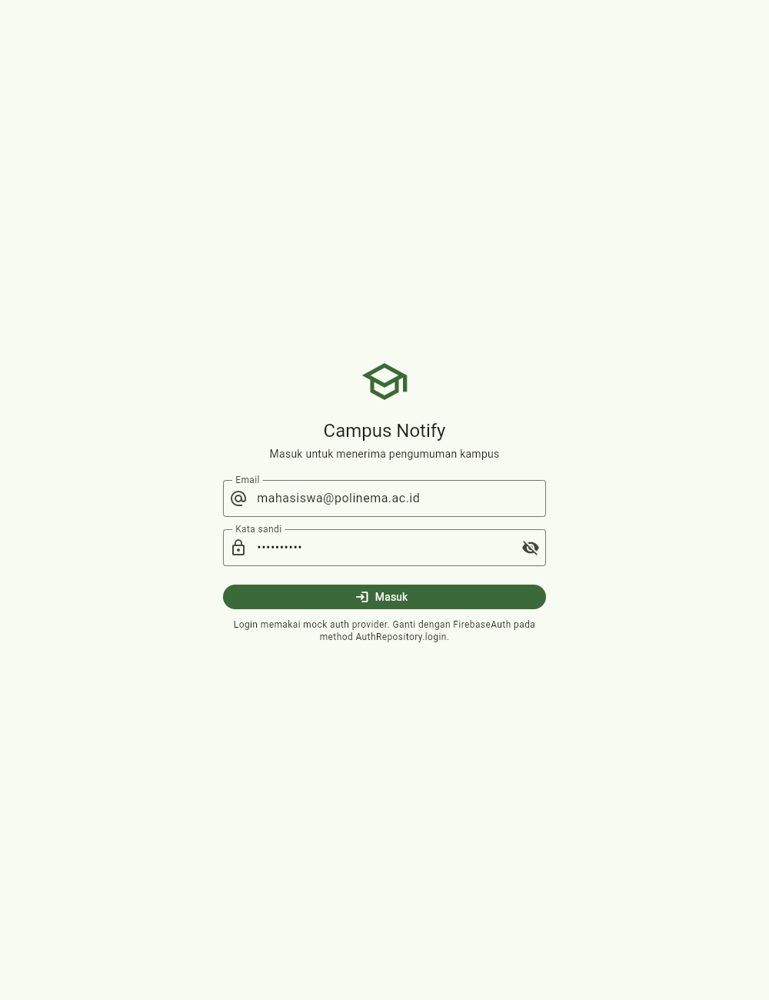
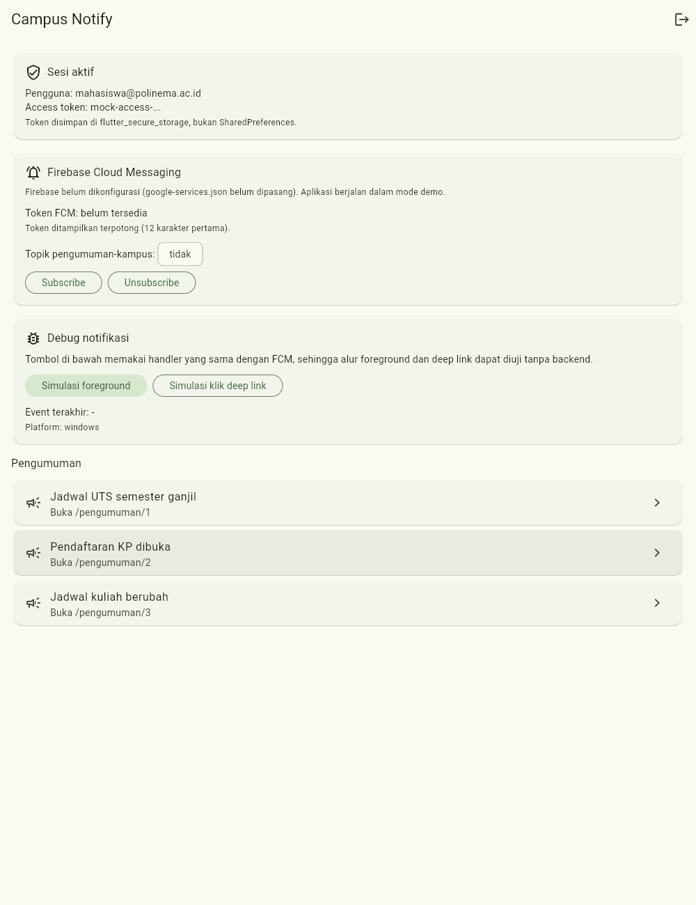
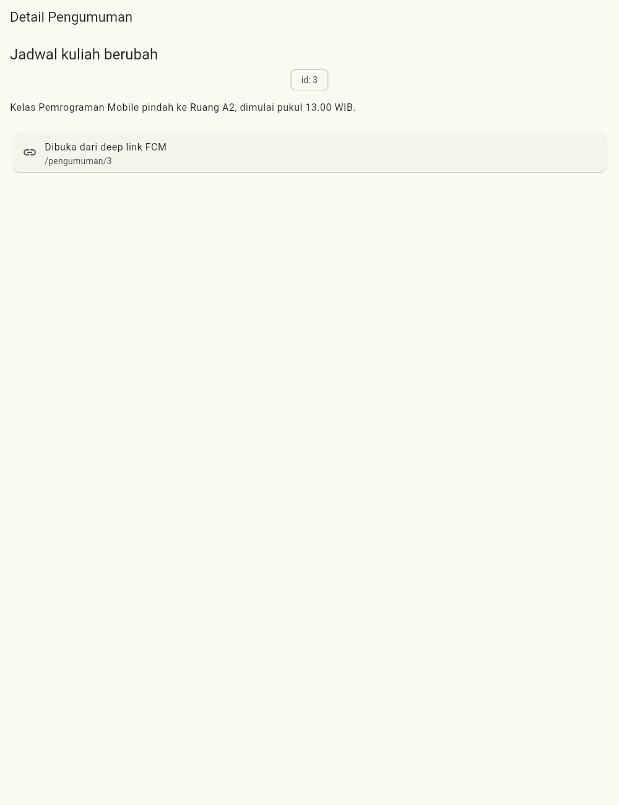

# Laporan Jobsheet Minggu 6
## Authentication, Security & FCM — Campus Notify

**Mata kuliah:** Pemrograman Mobile
**Tanggal pengujian:** 11 Oktober 2026
**Nama:** Raditya Riefki — **NIM:** 244107020204 — **Kelas:** TI-3E

---


### 1. Login dan guard route

Saat belum ada token, aplikasi otomatis membuka `/login`. Setelah login mock,
aplikasi masuk ke home dan token tersimpan di secure storage.



### 2. Sesi aktif dan token aman

Home menampilkan sesi aktif. **Access token ditampilkan terpotong**
(`mock-access-...`) — token penuh tidak pernah tampil di layar, log, atau
screenshot.



### 3. Deep link `/pengumuman/:id`

Rute yang sama dipakai oleh `data.route` pada payload FCM. Klik membuka detail
pengumuman yang benar.



### 4. Rute bertahan setelah reload

Reload langsung pada `/pengumuman/3` tetap menampilkan halaman tujuan.


### 5. Pemeriksaan kode dan test

Dijalankan ulang pada 11 Oktober 2026 (Flutter 3.47.1, Dart 3.13.1):

```text
flutter pub get                  -> Got dependencies!
flutter analyze                  -> No issues found! (ran in 63.3s)
flutter test                     -> All tests passed! (13 tests)
flutter build web --no-tree-shake-icons -> Built build\web
flutter build apk --debug        -> Built app-debug.apk
```

Output test lengkap:

```text
00:01 +13: All tests passed!
```

### 6. Capture screenshot otomatis (Playwright)

Screenshot di folder `screenshots/` dihasilkan ulang dari `build/web` yang
dilayani pada `http://127.0.0.1:8766` memakai `tool/capture_screenshots.py`:

```text
Captured: 01-halaman-login.png
Captured: 02-home-sesi-dan-token.png
Captured: 03-halaman-pengumuman-deep-link.png
Captured: 04-pengumuman-setelah-reload.png
{
  "result": "PASS",
  "screenshots": 4,
  "observations": [
    "guard route: belum login -> /login",
    "login mock -> home, token disimpan di secure storage",
    "token ditampilkan terpotong (12 karakter)",
    "deep link /pengumuman/3 membuka halaman tujuan",
    "rute detail bertahan setelah reload"
  ],
  "page_errors": []
}
```

## Tabel pengujian tiga app state

Uji FCM di perangkat memerlukan project Firebase + HP. Statusnya dicatat jujur
di bawah; bagian yang dapat diuji tanpa Firebase sudah dibuktikan (parsing route,
deep link, guard, penyimpanan token).

| State | Yang diharapkan | Cara uji | Status |
|---|---|---|---|
| Foreground | Banner lokal muncul, klik ke `/pengumuman/3` | Aplikasi terbuka, kirim dari console | Belum diuji di perangkat |
| Background | Banner sistem muncul, klik ke rute benar | Tekan Home, kirim, klik banner | Belum diuji di perangkat |
| Terminated | Buka ke rute benar via `getInitialMessage` | Swipe-close, kirim, klik banner | Belum diuji di perangkat |

Logika ketiga handler sudah ditulis pada `PushService` (`onMessage`,
`onMessageOpenedApp`, `getInitialMessage`) dan parsing `data.route` sudah diuji
unit test. Detail lengkap ada di [docs/04-hasil-testing.md](docs/04-hasil-testing.md).

## AI Challenge

Prompt dari jobsheet, output awal AI, perbaikan manual, dan keputusan teknis
didokumentasikan di folder `docs/`:

- [Prompt AI](docs/01-prompt-ai.md)
- [Output awal AI](docs/02-output-ai.md)
- [Verifikasi dan perbaikan manual](docs/03-verifikasi-fcm.md)
- [Hasil testing](docs/04-hasil-testing.md)

Ringkasan perbaikan manual atas draf AI:

1. API `flutter_local_notifications` 22.3.1 memakai parameter bernama.
2. `switch` `DioExceptionType` harus menangani `transformTimeout`.
3. `Firebase.initializeApp()` dibungkus `try/catch` agar aplikasi tidak crash
   saat `google-services.json` belum ada (mode demo).
4. Menambahkan core library desugaring dan `kotlin.incremental=false` agar build
   Android berhasil.

## Refleksi

**Mengapa refresh token tidak boleh di SharedPreferences?**
SharedPreferences menyimpan data sebagai teks biasa tanpa enkripsi. Bila perangkat
di-root atau data dicadangkan, refresh token bisa dibaca pihak lain dan dipakai
meminta access token baru. Karena itu token hanya disimpan di
`flutter_secure_storage` (Keystore/Keychain).

**Apa yang rusak bila `onTokenRefresh` diabaikan selama satu semester?**
Token bisa berubah (reinstall, clear data, rotasi keamanan). Backend akan terus
mengirim ke token basi, sehingga pengguna tidak menerima notifikasi padahal
aplikasi terlihat normal. Karena itu listener `onTokenRefresh` wajib ada.

**Kapan topik dan kapan token perangkat?**
Topik untuk broadcast: pengumuman kampus, info satu kelas, atau satu UKM. Token
perangkat untuk pesan personal: nilai, tagihan, atau jadwal pribadi.

**Bagian draf AI yang saya perbaiki.**
Draf memakai API `flutter_local_notifications` versi lama dan memanggil
`Firebase.initializeApp()` tanpa penanganan error. Keduanya saya perbaiki agar
kode kompilasi pada paket terbaru dan aplikasi tetap berjalan tanpa konfigurasi
Firebase.

## Referensi

- [FCM Flutter client](https://firebase.google.com/docs/cloud-messaging/flutter/client)
- [FCM message types: notification vs data](https://firebase.google.com/docs/cloud-messaging/concept-options)
- [Firebase Auth for Flutter](https://firebase.google.com/docs/auth/flutter/start)
- [flutter_secure_storage](https://pub.dev/packages/flutter_secure_storage)
- [flutter_local_notifications](https://pub.dev/packages/flutter_local_notifications)
- [GoRouter: redirect & deep linking](https://go_router.dev/)
- [OWASP Mobile Top 10](https://owasp.org/www-project-mobile-top-10/)
