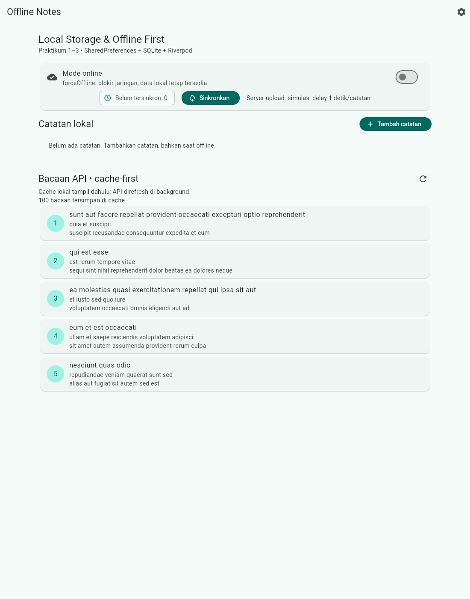
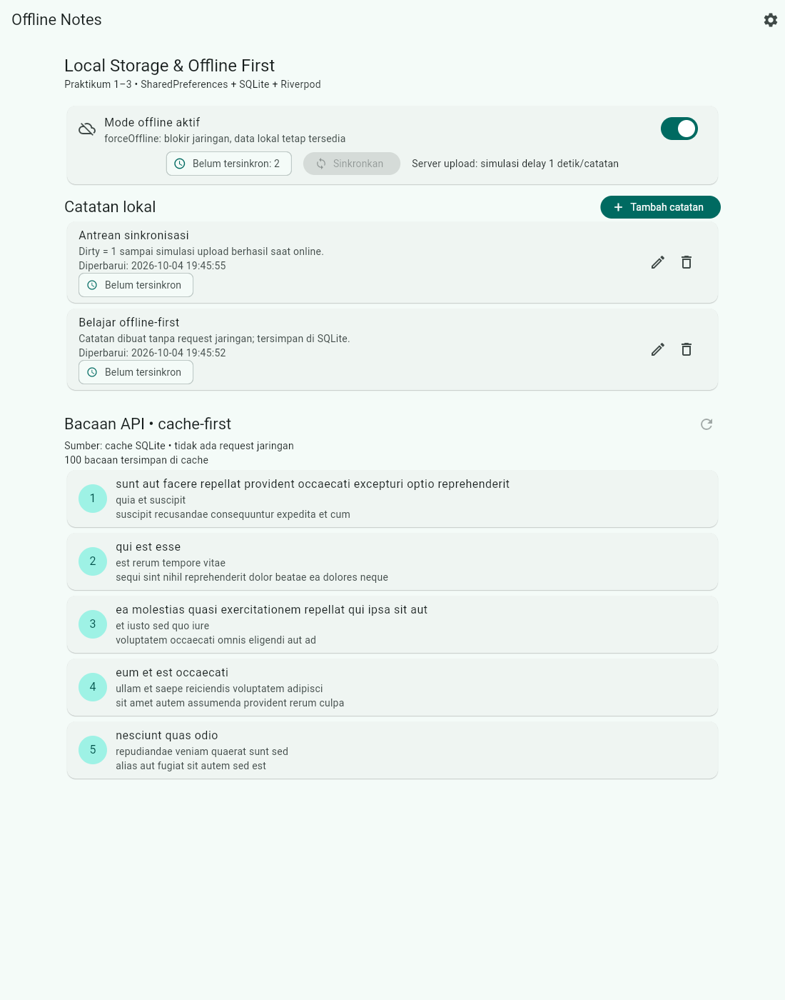
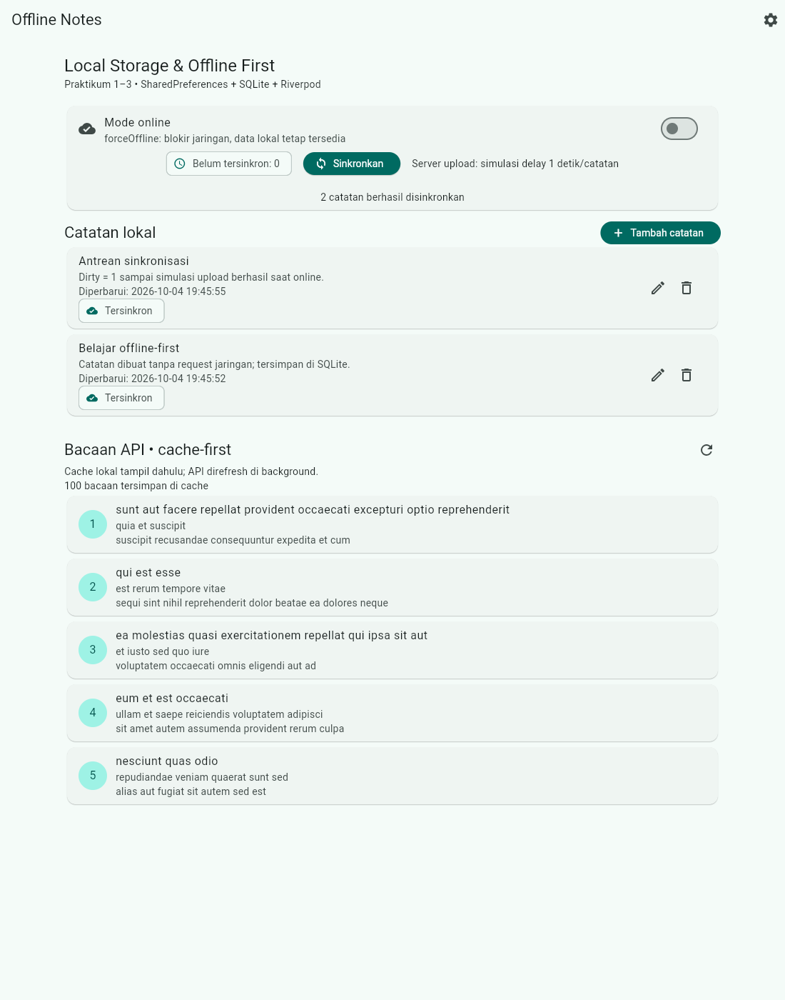
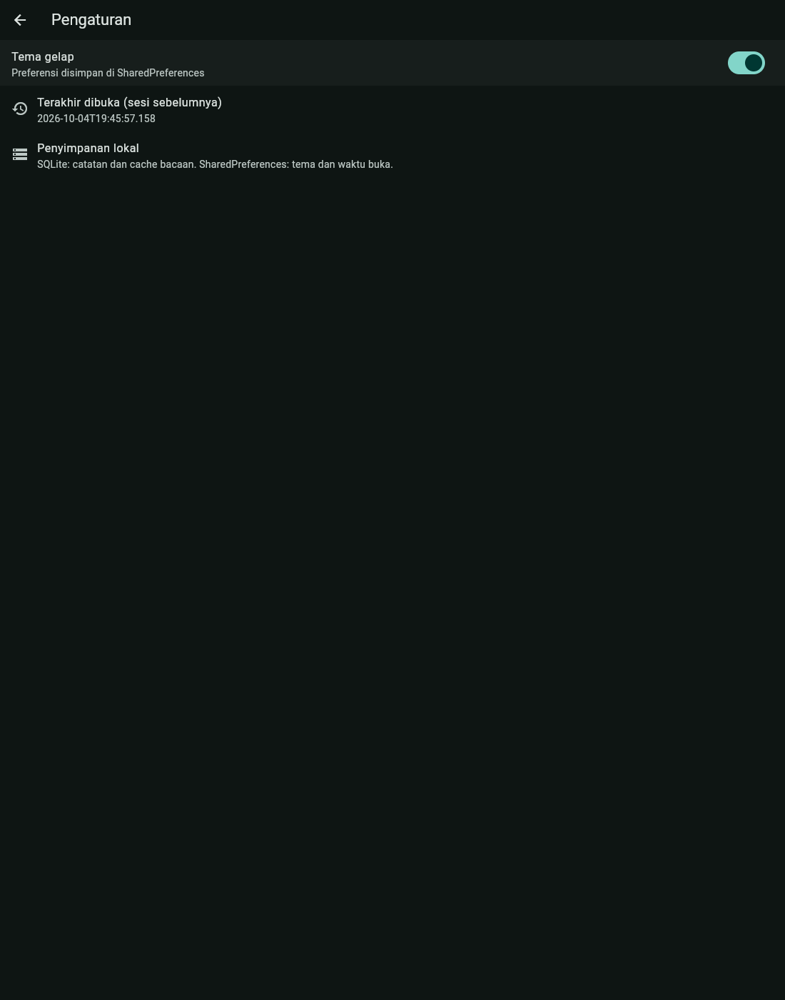
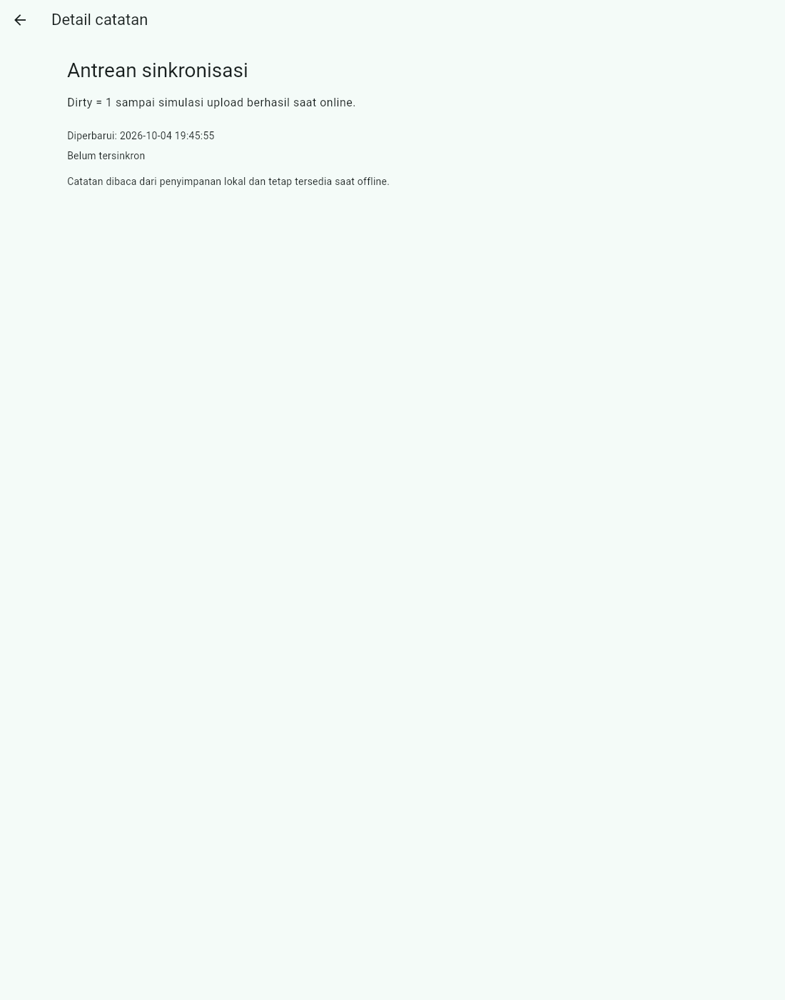

# Laporan Jobsheet Minggu 7
## Clean Architecture — Offline Notes (feature-first)

**Mata kuliah:** Pemrograman Mobile
**Nama:** Raditya Riefki
**NIM:** 244107020204
**Kelas:** TI-3E

```

### Bukti before / after

UI identik sebelum dan sesudah refactor; yang berbeda hanya struktur kode.
Screenshot "before" berasal dari project Minggu 5, "after" dari project ini.

| Skenario | Before | After |
|---|---|---|
| Belum ada catatan |  |  |
| Cache API 100 bacaan |  |  |
| Dua catatan offline (dirty 2) |  |  |
| Setelah sinkronisasi (dirty 0) |  |  |
| Pengaturan tema gelap |  |  |
| Detail catatan lokal |  |  |

Skenario "after" tambahan (reload offline & edit catatan):

- `screenshots/after/03-cache-dan-catatan-setelah-reload-offline.png`
- `screenshots/after/06-preferensi-setelah-reload.png`
- `screenshots/after/08-edit-catatan-offline.png`

## Testing (use case dengan repository palsu)

Domain diuji murni tanpa SQLite/Dio/Firebase, misalnya
[`test/get_notes_test.dart`](test/get_notes_test.dart):

```dart
test('GetNotes meneruskan daftar dari repository', () async {
  final repo = FakeNoteRepository(
    items: [Note(title: 'A', updatedAt: DateTime(2026, 9, 27))],
  );
  final result = await GetNotes(repo).call();
  expect(result.failure, isNull);
  expect(result.notes.first.title, 'A');
});
```

Cakupan test: use case notes & posts, validasi, sinkronisasi, repository
SQLite in-memory, model, dan widget. Detail:
[`docs/04-hasil-testing.md`](docs/04-hasil-testing.md).

## AI Challenge

Prompt, output awal AI, tabel usulan-vs-keputusan final, dan hasil grep
verifikasi tersimpan di folder `docs/`:

- [`docs/01-prompt-ai.md`](docs/01-prompt-ai.md)
- [`docs/02-output-ai.md`](docs/02-output-ai.md)
- [`docs/03-verifikasi-ai.md`](docs/03-verifikasi-ai.md)
- [`docs/04-hasil-testing.md`](docs/04-hasil-testing.md)
- [`docs/05-pemetaan-file.md`](docs/05-pemetaan-file.md)

Contoh usulan AI yang **ditolak**: base class `UseCase<Type, Params>`, layer
`datasources` terpisah, dan use case untuk setiap CRUD satu baris (pass-through).
Yang **diterima**: pemisahan entity/model, interface di domain, `SyncNotes`
sebagai use case, dan DI via provider Riverpod.

## Refleksi

- **Mengapa interface repository di domain, bukan data?** Karena `domain`
  adalah pemilik aturan bisnis; bila interface diletakkan di `data`, `domain`
  harus mengimpor `data` dan arah dependensi terbalik. Akibatnya logika bisnis
  tidak bisa diuji tanpa SQLite/jaringan.
- **Kapan use case benar-benar dibutuhkan?** Saat ada aturan bisnis
  (`AddNote`/`UpdateNote` validasi) atau orkestrasi >1 operasi (`SyncNotes`).
  Untuk baca satu baris (`GetNote`, `CountDirty`, `DeleteNote`), provider
  memanggil repository langsung agar tidak over-engineering.
- **Biaya over-engineering?** Use case + base class untuk tiap CRUD satu baris
  menambah file dan lapisan tanpa manfaat; untuk tim kecil ini memperlambat
  perubahan. Biayanya sepadan ketika logika tumbuh (multi-repository, validasi,
  sinkronisasi).
- **Bagian usulan AI yang ditolak?** Base class `UseCase`, `datasources`
  terpisah, entity `AppPreferences`, `dio_client` khusus, dan use case per CRUD
  satu baris — semuanya disederhanakan dengan alasan tertulis di
  `docs/03-verifikasi-ai.md`.
