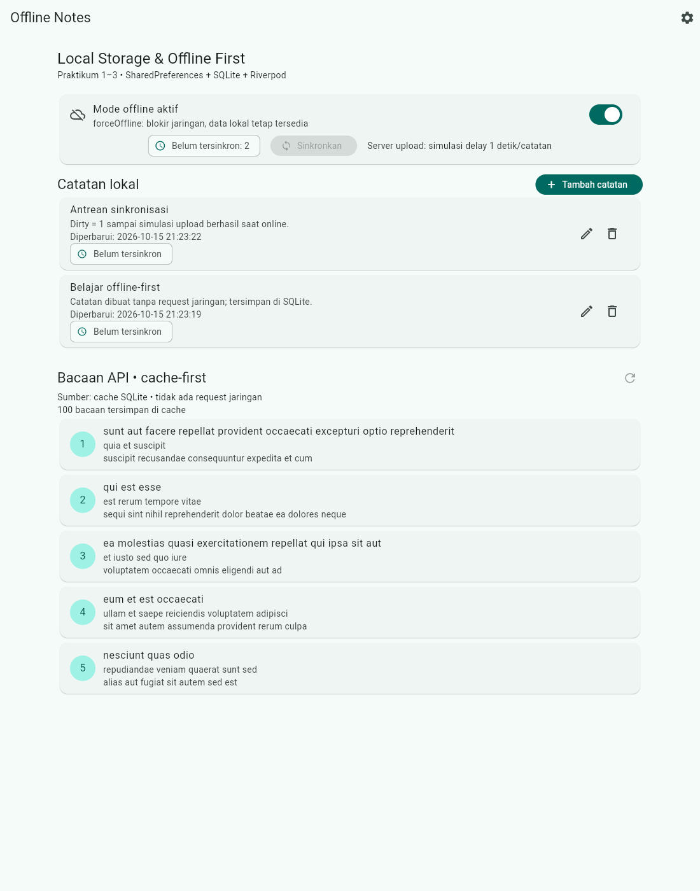
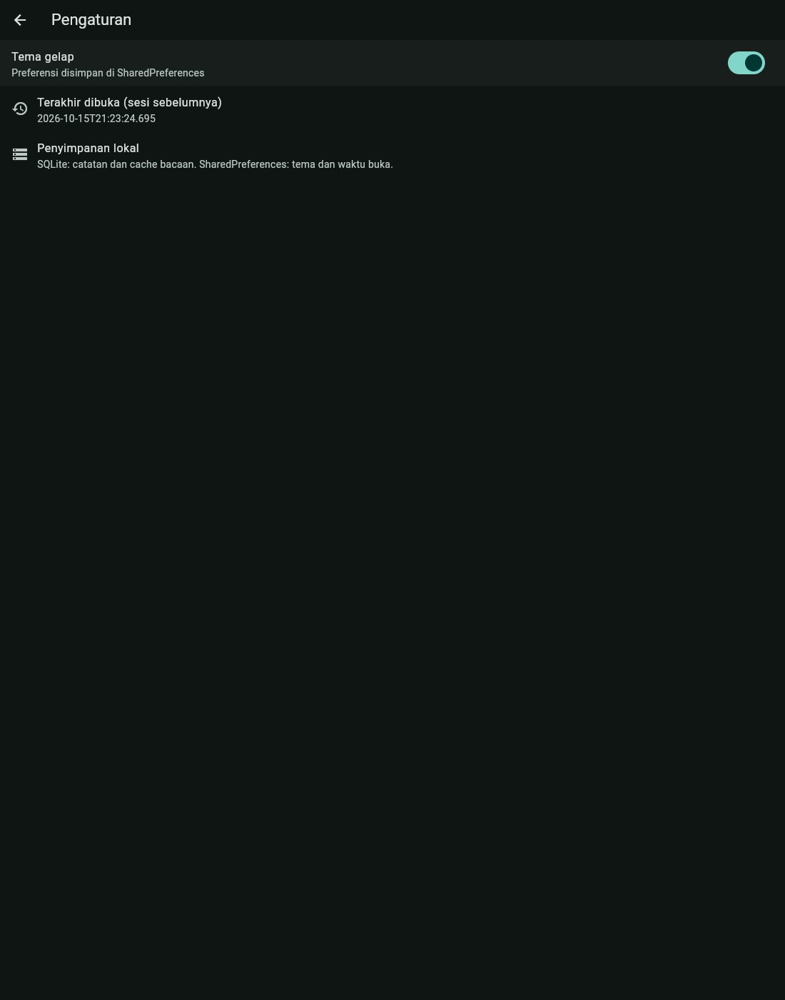

# Laporan Jobsheet Minggu 8

## Mid Project Review & Code Review

**Mata kuliah:** Pemrograman Mobile
**Nama:** Raditya Riefki
**NIM:** 244107020204
**Kelas:** TI-3E
**Tanggal:** 27 Oktober 2026

Project yang direview: [`week7_clean_notes`](../07-week-7-clean-architecture/week7_clean_notes)
(hasil refactor Clean Architecture Minggu 7). Week 8 tidak membuat aplikasi
baru; fokusnya audit, review, perbaikan kecil, dan bukti kualitas.

## Status paruh semester

| Aspek | Status | Bukti |
|---|---|---|
| Aplikasi berjalan identik dengan akhir Minggu 7 | Lulus | Perubahan hanya memindahkan pemanggilan hapus dari widget ke provider; screenshot ada di folder `screenshots/`. |
| `flutter analyze` | Lulus | `No issues found!` |
| `dart format` | Lulus | 13 file dirapikan lebih dulu; gate sekarang exit 0. |
| `flutter test` | Lulus | 25 test (naik dari 23), semuanya hijau. |
| Struktur feature-first | Lulus | Tiga grep sterility menghasilkan 0 match. |
| PR kecil + review | Lulus (lokal) | PR kode 76 insertions / 13 deletions (+ dokumentasi), 2 blocker resolved. |
| Issue + PR GitHub | Lulus | [Issue #1](https://github.com/raditya12/244107020204-mobile-course/issues/1) dan [PR #2](https://github.com/raditya12/244107020204-mobile-course/pull/2) sudah dipublikasikan dan di-merge ke `develop`. |
| `main` tidak disentuh | Lulus | `main` tetap di `c1aed75`; integrasi di `develop`. |

## Peta issue dan Pull Request

| Item | Isi | Status |
|---|---|---|
| [Issue #1](https://github.com/raditya12/244107020204-mobile-course/issues/1) | `fix(notes): hapus catatan masih memanggil repository langsung dari widget` | Dibuat di GitHub |
| [PR #2](https://github.com/raditya12/244107020204-mobile-course/pull/2) | `refactor(notes): pindahkan hapus catatan dari widget ke provider + test` | Dibuat, direview, di-merge |
| Branch | `fix/notes-delete-layer` (dari `develop`) | Selesai |
| Commit kode | `refactor(notes): pindahkan hapus catatan dari widget ke provider + test` | Selesai |
| Commit dokumentasi | `docs(week8): laporan mid project review + verifikasi AI` | Selesai |
| Review | 5 komentar (2 blocker, 3 saran); 2 resolved, 2 ditolak, 1 ditunda | Approve |
| Merge | `--no-ff` ke `develop` | Selesai |
| CI | `.github/workflows/ci.yml` (format, analyze, test) | Berjalan pada PR |

Alur yang dipakai:

```text
main (tidak disentuh)
└── develop
    ├── chore/quality-gate
    │   ├── style: rapikan format lib dan test
    │   └── chore(ci): tambah workflow analyze, format, dan test
    └── fix/notes-delete-layer
        ├── refactor(notes): pindahkan hapus catatan dari widget ke provider + test
        └── docs(week8): laporan mid project review + verifikasi AI
```

## Fitur utama aplikasi yang direview

- Catatan lokal SQLite: tambah, ubah, hapus, detail.
- Status `dirty` dan sinkronisasi simulasi dengan urutan `updatedAt`.
- Mode offline yang memblokir jaringan tanpa menghilangkan data lokal.
- Cache bacaan API (Dio + SQLite, cache-first).
- Preferensi tema gelap dan waktu terakhir dibuka (SharedPreferences).
- Routing dengan GoRouter dan state management Riverpod.

## Stack teknologi

| Bagian | Teknologi |
|---|---|
| Framework | Flutter 3.47.1 / Dart 3.13.1 |
| State management | Riverpod 3.4.3 |
| Routing | GoRouter 18 |
| Penyimpanan lokal | SQLite (`sqflite`, `sqflite_common_ffi`) |
| Preferensi | SharedPreferences |
| Jaringan | Dio 5 |
| Arsitektur | feature-first Clean Architecture (`presentation -> domain <- data`) |
| CI | GitHub Actions |

## Cara menjalankan

```bash
cd 07-week-7-clean-architecture/week7_clean_notes
flutter pub get
flutter run -d chrome
```

Pemeriksaan mesin:

```bash
flutter analyze
dart format --output=none --set-exit-if-changed lib test
flutter test
```

## Hasil pemeriksaan mesin

```text
flutter analyze
No issues found!

dart format --output=none --set-exit-if-changed lib test
exit code 0

flutter test
+25: All tests passed!
```

Cakupan test: use case notes/posts, validasi, sinkronisasi, repository SQLite
in-memory, model, widget, dan aksi hapus catatan.

## Struktur folder Week 8

```text
08-week-8-mid-project-review/
├── README.md
├── docs/
│   ├── 01-prompt-ai.md
│   ├── 02-output-ai.md
│   ├── ai-review-vs-keputusan.md
│   ├── issue-pr-draft.md
│   ├── peer-review.md
│   └── review-checklist.md
└── screenshots/
    ├── 00-catatan-kosong.png
    ├── 02-offline-dirty-sebelum-sync.png
    ├── 04-online-dirty-setelah-sync.png
    ├── 05-pengaturan-tema-gelap.png
    └── 07-detail-catatan-lokal.png
```

## Screenshot

Screenshot berasal dari build Week 7 setelah refactor. UI tidak berubah pada
Week 8 karena perubahan hanya memindahkan pemanggilan repository dari widget
ke provider.

| Skenario | Screenshot |
|---|---|
| Belum ada catatan |  |
| Dua catatan offline (dirty 2) |  |
| Setelah sinkronisasi (dirty 0) |  |
| Detail catatan lokal |  |
| Pengaturan tema gelap |  |

## Temuan review utama

1. **Blocker - arsitektur:** `notes_page.dart` memanggil
   `noteRepositoryProvider.deleteNote` langsung dari widget
   (`notes_page.dart:224-225` sebelum refactor). Diperbaiki dengan
   `NotesActions` provider di `notes_actions.dart`.
2. **Blocker - test:** belum ada test jalur hapus. Ditambahkan 2 test di
   `test/notes_actions_test.dart` (sukses dan gagal).
3. **Saran - error path:** `dirtyCountProvider` menelan failure dan
   menampilkan 0. Temuan valid, ditunda ke issue lanjutan agar PR tetap kecil.
4. **Saran - over-engineering:** usulan `freezed`, `Either`, `get_it`, dan base
   `UseCase` ditolak karena menambah lapisan/dependensi tanpa manfaat untuk
   CRUD kecil.

Detail ada di [`docs/peer-review.md`](docs/peer-review.md) dan
[`docs/review-checklist.md`](docs/review-checklist.md).

## Verifikasi review AI

Prompt, output awal, tabel usulan-vs-keputusan, dan bukti grep/test disimpan di:

- [`docs/01-prompt-ai.md`](docs/01-prompt-ai.md)
- [`docs/02-output-ai.md`](docs/02-output-ai.md)
- [`docs/ai-review-vs-keputusan.md`](docs/ai-review-vs-keputusan.md)

Ringkasan: dari 5 temuan AI + 1 tambahan, 2 diterapkan (pelanggaran layer dan
test hapus), 2 ditunda dengan alasan, 1 false positive ditolak (presentation
dianggap mengimpor data layer), dan 1 usulan over-engineering ditolak.

## CI

Workflow di root repository:

```yaml
name: ci
on:
  pull_request:
  push:
    branches: [develop]
jobs:
  verify:
    runs-on: ubuntu-latest
    defaults:
      run:
        working-directory: 07-week-7-clean-architecture/week7_clean_notes
    steps:
      - uses: actions/checkout@v4
      - uses: subosito/flutter-action@v2
        with:
          channel: stable
          cache: true
      - run: flutter pub get
      - run: dart format --output=none --set-exit-if-changed lib test
      - run: flutter analyze
      - run: flutter test
```

## Refleksi

- **Beda LGTM buta dan approve yang bertanggung jawab:** LGTM buta hanya melihat
  diff dan menganggap "tidak error" berarti aman. Approve yang bertanggung
  jawab berarti reviewer menjalankan analyze/test, menelusuri alur gagal, dan
  berani meminta perubahan. Risikonya: bug lolos ke `develop` dan baru ketahuan
  saat demo atau setelah fitur lain menumpuk.
- **Kapan request changes, kapan cukup saran:** request changes dipakai untuk
  pelanggaran layer dan celah test yang memengaruhi kebenaran. Saran dipakai
  untuk keterbacaan, penamaan, atau perbaikan yang bisa menyusul tanpa
  menghambat merge.
- **Bagian review AI yang ditolak:** klaim bahwa presentation mengimpor data
  layer (terbukti 0 match) dan usulan `freezed`/`Either`/`get_it`. Keduanya
  ditolak dengan bukti grep dan alasan arsitektur, bukan karena "tidak suka".
- **Satu perbaikan konkret setelah review:** aksi hapus dipindah dari widget ke
  `NotesActions`. Dampaknya widget tidak lagi tahu repository, invalidasi state
  terpusat, dan jalur hapus sekarang punya test sukses/gagal.

## Catatan

Issue [#1](https://github.com/raditya12/244107020204-mobile-course/issues/1)
dan Pull Request
[#2](https://github.com/raditya12/244107020204-mobile-course/pull/2) sudah
dipublikasikan ke GitHub dan di-merge ke `develop`. Dokumen
[`docs/issue-pr-draft.md`](docs/issue-pr-draft.md) tetap disimpan sebagai
template untuk PR berikutnya. `main` tidak disentuh dan dua file yang sudah
termodifikasi sebelum praktikum (`.vscode/settings.json` dan README Week 5)
tidak ikut di-commit.