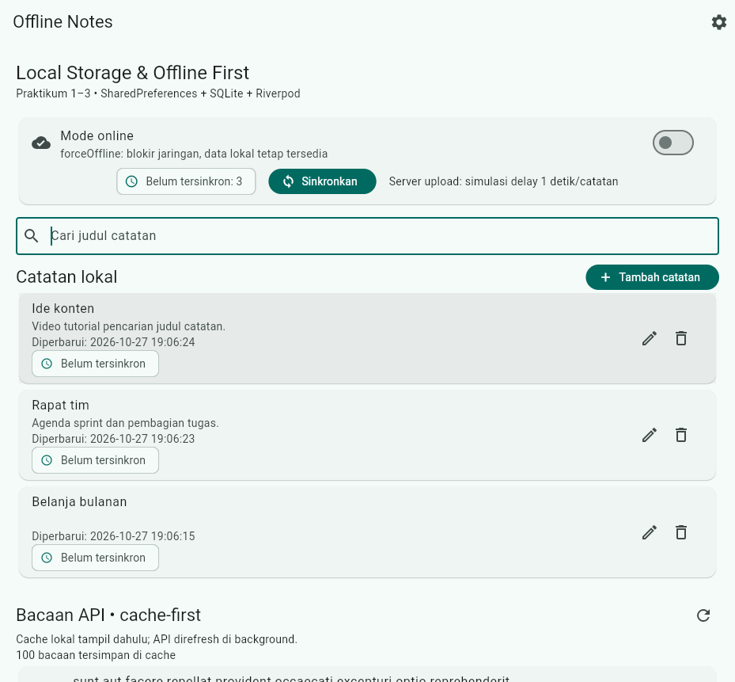
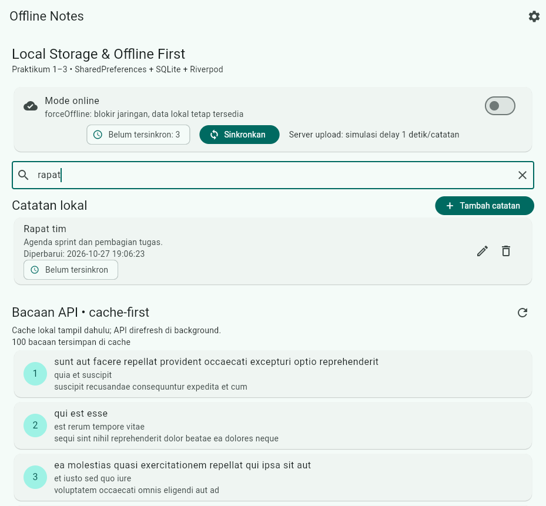
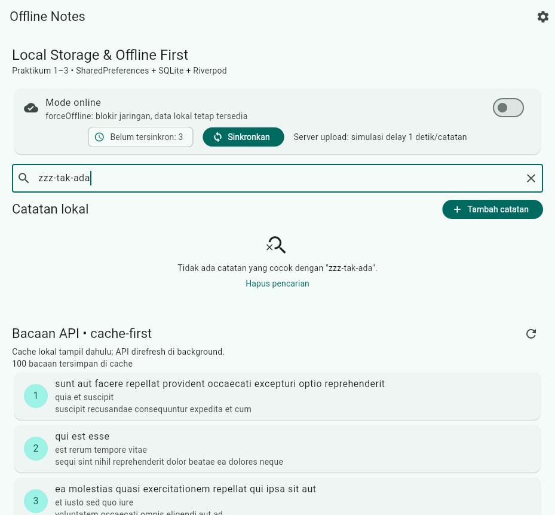

# Laporan Jobsheet Minggu 9

## AI-Assisted Development / Vibe Coding

**Mata kuliah:** Pemrograman Mobile
**Nama:** Raditya Riefki
**NIM:** 244107020204
**Kelas:** TI-3E
**Tanggal:** 27 Oktober 2026

Project kerja: [`week9_ai_notes`](week9_ai_notes) — salinan project
`week7_clean_notes` (Clean Architecture Minggu 7) yang ditambah satu fitur
kecil dengan bantuan AI. Week 9 tidak membuat aplikasi baru.

## Fitur yang ditambahkan

Pencarian judul catatan pada halaman Offline Notes:

- query di-trim dan dicocokkan tanpa membedakan huruf besar/kecil;
- hanya judul yang dicari, bukan isi catatan;
- query kosong menampilkan semua catatan;
- empty state khusus ketika tidak ada hasil, lengkap dengan tombol
  `Hapus pencarian`;
- aturan pencarian berada di use case domain murni, bukan di widget.

## Status jobsheet

| Aspek | Status | Bukti |
|---|---|---|
| Fitur kecil dengan AI (search) + empty state | Lulus | [`search_notes.dart`](week9_ai_notes/lib/features/notes/domain/usecases/search_notes.dart) dan [`notes_page.dart`](week9_ai_notes/lib/features/notes/presentation/pages/notes_page.dart) |
| Prompt 5 slot + konteks | Lulus | [`docs/ai-log.md`](docs/ai-log.md) |
| Output awal AI disimpan | Lulus | [`docs/ai-log.md`](docs/ai-log.md#2-output-awal-ai) |
| 1 temuan AI terbukti benar lalu diperbaiki | Lulus | Test case-sensitive merah, lalu hijau |
| 1 temuan AI ditolak dengan alasan | Lulus | Usulan `searchNotes()` di repository ditolak |
| Keputusan tiap file | Lulus | Tabel di [`docs/ai-log.md`](docs/ai-log.md#keputusan-tiap-file) |
| `flutter analyze` | Lulus | `No issues found!` |
| `dart format` | Lulus | `Formatted 46 files (0 changed)` |
| `flutter test` | Lulus | 31 test, semua hijau |
| Screenshot hasil | Lulus | Folder [`screenshots/`](screenshots) |
| Tidak menempel secret ke AI | Lulus | Konteks hanya struktur folder, versi package, dan entity |

## Stack teknologi

| Bagian | Teknologi |
|---|---|
| Framework | Flutter 3.47.1 / Dart 3.13.1 |
| State management | Riverpod 3.4.3 |
| Routing | GoRouter 18.0.2 |
| Penyimpanan lokal | SQLite (`sqflite`, `sqflite_common_ffi`) |
| Preferensi | SharedPreferences 2.5.5 |
| Jaringan | Dio 5.11.1 |
| Arsitektur | feature-first Clean Architecture (`presentation -> domain <- data`) |

## Cara menjalankan

```bash
cd 09-week-9-ai-assisted-development/week9_ai_notes
flutter pub get
flutter run -d chrome
```

Pemeriksaan mesin:

```bash
flutter analyze
dart format --output=none --set-exit-if-changed lib test
flutter test
```

Uji manual:

1. Tambahkan beberapa catatan.
2. Ketik `rapat` pada kolom pencarian; hanya catatan yang judulnya cocok
   yang tampil.
3. Ketik `zzz-tak-ada`; empty state muncul.
4. Klik `Hapus pencarian`; semua catatan kembali tampil.

## Hasil pemeriksaan mesin

```text
flutter analyze
No issues found! (ran in 127.5s)

dart format --output=none --set-exit-if-changed lib test
Formatted 46 files (0 changed) in 0.12 seconds.
format_exit=0

flutter test
+31: All tests passed!
```

31 test terdiri dari 25 test lama Minggu 7 dan 6 test baru:

- 5 test domain di [`test/search_notes_test.dart`](week9_ai_notes/test/search_notes_test.dart);
- 1 widget test di [`test/search_widget_test.dart`](week9_ai_notes/test/search_widget_test.dart).

## Alur AI-assisted development

Prompt inti yang dipakai:

```text
Peran: senior Flutter developer yang disiplin Clean Architecture.
Konteks: feature-first, presentation -> domain <- data, Riverpod 3,
SQLite, Dio, GoRouter.
Tugas: tambah pencarian judul catatan + empty state.
Batas: jangan ubah arsitektur; jangan panggil SQLite/Dio dari widget;
maksimal 80 baris kode baru; jangan ubah entity/repository.
Output: kode use case + provider + widget, minimal 1 test sukses
dan 1 test gagal, dan cara uji manual.
```

Siklus yang dijalankan:

```text
Prompt -> Generate -> Verify -> Test -> Refactor -> Explain
```

- **Generate:** AI mengusulkan `SearchNotes`, provider, field pencarian, dan test.
- **Verify:** import domain dicek; method yang dipakai dipastikan ada.
- **Test:** test case-sensitive merah, lalu diperbaiki sampai hijau.
- **Refactor:** empty state diekstrak, field pencarian dipisah ke widget sendiri,
  dan filter dipindah ke use case/derived provider.
- **Explain:** keputusan dijelaskan di refleksi tanpa membuka AI.

Detail prompt, output awal, verifikasi, dan bukti grep ada di
[`docs/ai-log.md`](docs/ai-log.md). Hasil test dan uji manual ada di
[`docs/testing.md`](docs/testing.md).

## Bukti bug/halusinasi AI

Pola yang ditemukan: **logika yakin tapi salah**. Draft AI memakai
`String.contains` tanpa menormalkan huruf, sehingga query `belanja` tidak
menemukan `Belanja bulanan`.

Test pembuktian:

```dart
test('pencarian judul mengabaikan huruf besar/kecil', () {
  expect(search(notes, 'belanja'), hasLength(2));
});
```

Output merah:

```text
00:00 +1 -1: pencarian judul mengabaikan huruf besar/kecil [E]
  Expected: an object with length of <2>
    Actual: []
     Which: has length of <0>
00:00 +4 -1: Some tests failed.
```

Perbaikan: query dan judul sama-sama di-`toLowerCase()` di
[`search_notes.dart:10-14`](week9_ai_notes/lib/features/notes/domain/usecases/search_notes.dart).
Setelah perbaikan, 6 test search hijau dan seluruh suite menjadi 31 test hijau.

## Tabel temuan AI vs keputusan

| # | Temuan/usulan AI | Level | Keputusan | Alasan teknis |
|---|---|---|---|---|
| 1 | Filter judul masih case-sensitive | Blocker | Diterima, diperbaiki | Test merah membuktikan 2 hasil diharapkan tetapi 0 didapat. |
| 2 | Tambah `searchNotes()` ke repository + SQL `LIKE` | Blocker (arsitektur) | Ditolak | Kontrak repository tidak punya method itu (grep 0 match). Search berjalan pada daftar yang sudah dimuat; menambah method, migrasi, dan index untuk fitur kecil melanggar batas prompt dan menduplikasi aturan filter. |
| 3 | Ganti field inline dengan `SearchAnchor`/`SearchDelegate` | Saran | Ditolak | Overkill; menambah route/overlay dan mempersulit empty state. Field inline sudah lolos widget test. |
| 4 | Debounce query 300 ms | Saran | Ditolak | Filter in-memory tanpa I/O per ketikan; timer menambah kompleksitas dan flaky test tanpa manfaat terukur. |
| 5 | Tampilkan jumlah hasil + highlight | Saran | Ditunda | Bukan scope jobsheet; highlight butuh `RichText` dan perubahan `NoteTile`. |

Keputusan file: `search_notes.dart` diterima + refactor, `notes_providers.dart`
diterima, `notes_search_field.dart` diterima + refactor, `notes_page.dart`
diterima + refactor, dan test diterima + diperluas.

## Screenshot

| Skenario | Screenshot |
|---|---|
| Tiga catatan, query kosong |  |
| Query `rapat` (case-insensitive) |  |
| Query `zzz-tak-ada` (empty state) |  |

Screenshot diambil dari build web nyata yang dijalankan lokal. Catatan dibuat
lewat UI, bukan di-seed langsung ke database.

## Struktur folder Week 9

```text
09-week-9-ai-assisted-development/
├── README.md
├── docs/
│   ├── ai-log.md
│   └── testing.md
├── screenshots/
│   ├── 00-daftar-catatan.png
│   ├── 01-search-cocok.png
│   └── 02-search-kosong.png
└── week9_ai_notes/
    ├── lib/features/notes/
    │   ├── domain/usecases/search_notes.dart
    │   └── presentation/
    │       ├── pages/notes_page.dart
    │       ├── providers/notes_providers.dart
    │       └── widgets/notes_search_field.dart
    └── test/
        ├── search_notes_test.dart
        └── search_widget_test.dart
```

## Refleksi

- **Satu halusinasi AI dan cara membuktikannya:** filter case-sensitive.
  AI terlihat yakin karena kode lolos analyze, tetapi satu test kecil
  (`'belanja'` harus menemukan `Belanja bulanan` dan `Rapat BELANJA tim`)
  langsung merah dengan hasil 0. Bukti itu yang dipakai untuk memperbaiki kode,
  bukan asumsi.
- **Prompt mana yang paling membantu dan apa yang diubah:** prompt 5 slot dengan
  batas layer paling membantu karena AI tidak menambah dependensi atau
  memindahkan query ke SQLite. Setelah verifikasi, kriteria diperjelas:
  pencarian harus case-insensitive dan hanya membaca judul.
- **Satu refactor pada kode AI:** filter dipindahkan ke use case domain murni
  dan hasilnya diturunkan lewat `searchedNotesProvider`; widget hanya membaca
  state. Empty state juga diekstrak dari inline widget agar mudah diuji.
- **Keputusan terima/tolak paling sulit:** menolak `searchNotes()` di repository
  dengan SQL `LIKE`. Secara skalabilitas query SQL menarik, tetapi untuk daftar
  catatan lokal yang sudah dimuat, itu menambah method, migrasi, dan duplikasi
  aturan filter. Keputusan diambil berdasarkan scope fitur kecil dan dependency
  rule, bukan karena SQL tidak layak.

## Referensi

- [Jobsheet Minggu 9](https://jti-polinema.github.io/flutter-codelab/09-minggu-9-ai-assisted-development-vibe-coding/index.html)
- [`docs/ai-log.md`](docs/ai-log.md) — prompt, output AI, verifikasi, keputusan.
- [`docs/testing.md`](docs/testing.md) — cakupan test dan uji manual.