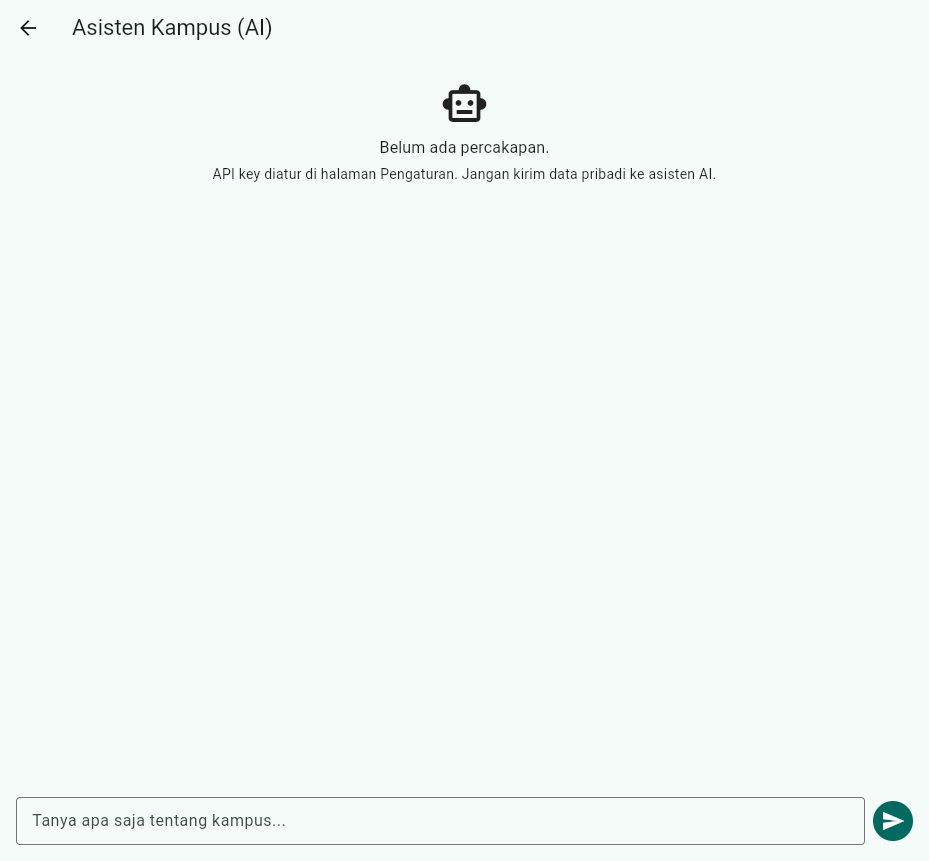
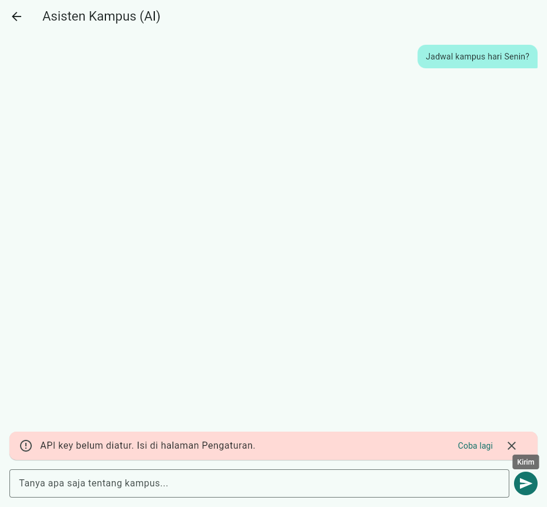
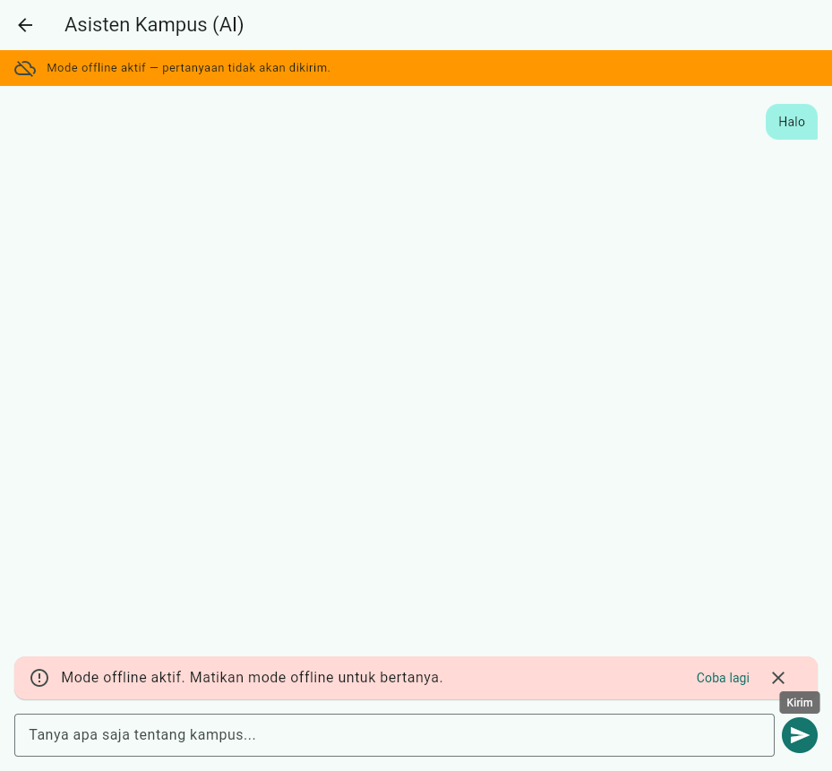
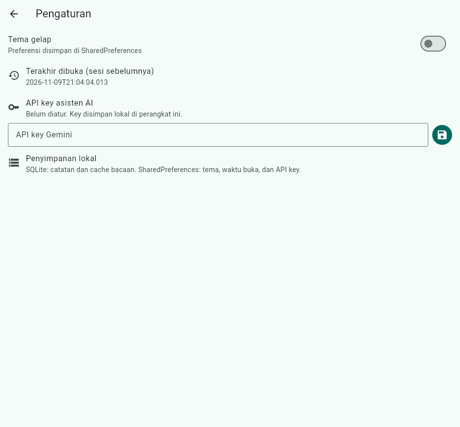

# Laporan Jobsheet Minggu 10

## Integrasi Fitur AI

**Mata kuliah:** Pemrograman Mobile
**Nama:** Raditya Riefki
**NIM:** 244107020204
**Kelas:** TI-3E
**Tanggal:** 9 November 2026

Project kerja: kode aplikasi di folder ini (lihat [`lib/`](lib)), salinan
project Minggu 9 ([`09-week-9-ai-assisted-development`](../09-week-9-ai-assisted-development))
yang ditambah satu fitur AI. Week 10 tidak membuat aplikasi baru.

## Fitur yang ditambahkan

**Chat asisten AI** (Gemini `generateContent`) pada halaman `/chat`:

- system prompt singkat: asisten kampus ramah, Bahasa Indonesia, maksimal
  2 kalimat, tidak meminta data pribadi;
- arsitektur feature-first: use case murni `AskAssistant`, kontrak
  `AssistantRepository` di domain, implementasi Gemini via Dio di data;
- API key diinput pengguna di halaman Pengaturan dan disimpan lokal
  (SharedPreferences) — tidak pernah hardcode;
- fallback lengkap: blokir saat mode offline, pesan ramah untuk API error,
  tombol "Coba lagi" untuk mengirim ulang pertanyaan terakhir;
- empty state dengan peringatan privasi sebelum percakapan dimulai.

## Status jobsheet

| Aspek | Status | Bukti |
|---|---|---|
| Satu fitur AI (chat) | Lulus | [`chat_page.dart`](lib/features/assistant/presentation/pages/chat_page.dart), [`gemini_assistant_repository.dart`](lib/features/assistant/data/repositories/gemini_assistant_repository.dart) |
| System prompt + user prompt di `docs/ai-log.md` | Lulus | [`docs/ai-log.md`](docs/ai-log.md) |
| Output awal AI disimpan | Lulus | [`docs/ai-log.md#2-output-awal-ai`](docs/ai-log.md#2-output-awal-ai) |
| Bukti mesin hijau | Lulus | analyze bersih, 42 test hijau (stabil 3x) |
| 1 temuan AI terbukti benar lalu diperbaiki | Lulus | Parsing crash → test merah → hijau |
| Saran AI ditolak beralasan | Lulus | 3 usulan ditolak/ditunda di tabel keputusan |
| Tabel risiko + mitigasi | Lulus | Bagian di bawah |
| Tidak kirim data sensitif ke AI | Lulus | System prompt melarang; tidak ada data pribadi dikirim; grep 0 secret |
| Screenshot hasil | Lulus | Folder [`screenshots/`](screenshots) |

## Stack teknologi

| Bagian | Teknologi |
|---|---|
| Framework | Flutter 3.47.1 / Dart 3.13.1 |
| State management | Riverpod 3.4.3 |
| Routing | GoRouter 18.0.2 |
| AI API | Google Gemini `generateContent` (v1beta, `gemini-2.0-flash`) |
| HTTP client | Dio 5.11.1 |
| Penyimpanan key | SharedPreferences (lokal per perangkat) |
| Penyimpanan data | SQLite (`sqflite`, `sqflite_common_ffi`) |
| Arsitektur | feature-first Clean Architecture (`presentation -> domain <- data`) |

## Cara menjalankan

```bash
cd 10-week-10-ai-feature-integration
flutter pub get
flutter run -d chrome
```

Mengaktifkan fitur AI:

1. Buka **Pengaturan → API key asisten AI**, tempel API key Gemini milikmu
   (dapat dari [Google AI Studio](https://ai.google.dev/)). Key hanya
   tersimpan di perangkat lokal, tidak pernah di-commit.
2. Buka ikon **Asisten AI** di halaman utama, ketik pertanyaan.

Tanpa API key, aplikasi tetap berjalan: chat menampilkan pesan arahan yang
ramah, dan seluruh test tetap hijau karena memakai repository palsu.

Pemeriksaan mesin:

```bash
flutter analyze
dart format --output=none --set-exit-if-changed lib test
flutter test
```

## Hasil pemeriksaan mesin

```text
flutter analyze
No issues found! (ran in 3.7s)

dart format --output=none --set-exit-if-changed lib test
Formatted 56 files (0 changed) in 0.15 seconds.
format_exit=0

flutter test (3x beruntun)
00:11 +42: All tests passed!
00:08 +42: All tests passed!
00:17 +42: All tests passed!
```

42 test = 36 test lama Minggu 9 + 11 test baru fitur assistant
(4 parsing Gemini, 3 use case, 4 widget), dengan satu test lama
(`markSynced`) diberi perbaikan flaky. Detail:
[`docs/testing.md`](docs/testing.md).

## Tabel risiko dan mitigasi

| Risiko | Mitigasi yang diterapkan |
|---|---|
| Bocor data pengguna ke AI API | System prompt melarang meminta data pribadi; aplikasi tidak mengirim profil/jadwal/catatan pengguna ke API — hanya teks pertanyaan. Peringatan privasi tampil di empty state. |
| API key bocor | Key tidak pernah hardcode; diinput pengguna dan disimpan lokal per perangkat; kolom input obscured; grep membuktikan 0 secret di kode. |
| Biaya melonjak | `maxOutputTokens: 200` membatasi panjang jawaban; request hanya terjadi saat pengguna menekan kirim; tanpa retry otomatis berulang. |
| API error / down | `DioException` diterjemahkan menjadi pesan ramah per kategori (key tidak valid, layanan tidak tersedia); tombol "Coba lagi"; mode offline memblokir request sebelum keluar jaringan. |
| Respons tidak relevan/kosong | Parsing defensif: jawaban kosong atau diblokir keamanan dikembalikan sebagai `NetworkFailure` dengan pesan jelas, bukan crash atau teks kosong di UI. |
| Key disimpan di SharedPreferences (bukan secure storage) | Diterima untuk lingkup lab/web dengan catatan risiko di README; migrasi ke `flutter_secure_storage` dicatat sebagai lanjutan di `docs/ai-log.md`. |

## Alur AI-assisted development

```text
Prompt -> Generate -> Verify -> Test -> Refactor -> Explain
```

- **Generate:** AI mengusulkan entity, kontrak repository, use case,
  repository Gemini, provider chat, dan halaman chat.
- **Verify:** import dicek (domain steril), API Gemini diverifikasi,
  parsing diuji dengan empat bentuk respons nyata.
- **Test:** parsing draft merah (3 crash), lalu hijau setelah parsing
  defensif; flaky test lama ditemukan dan diperbaiki.
- **Refactor:** fallback offline dipindah ke notifier, validasi ke use case,
  kartu error diekstrak, controller dilepas dengan benar.
- **Explain:** keputusan dijelaskan di refleksi tanpa membuka AI.

Detail prompt, output awal, verifikasi, dan bukti grep ada di
[`docs/ai-log.md`](docs/ai-log.md).

## Bukti bug/halusinasi AI

Draft AI mengasumsikan respons Gemini selalu berisi teks dan mengakses
`candidates[0]['content']['parts'][0]['text']` langsung. Tiga respons nyata
Gemini membuatnya crash:

```text
00:00 +1 -1: extractReply mengembalikan failure bila candidates kosong [E]
  RangeError (length): Invalid value: Valid value range is empty: 0
00:00 +1 -2: extractReply mengembalikan failure bila jawaban diblokir [E]
  NoSuchMethodError: The method '[]' was called on null.
00:00 +1 -3: extractReply mengembalikan failure bila semua parts tanpa teks [E]
  type 'Null' is not a subtype of type 'String' in type cast
00:00 +1 -3: Some tests failed.
```

Perbaikan: parsing level-per-level dengan pengembalian `NetworkFailure`
berpesan ramah. Setelah perbaikan 4 test parsing hijau dan suite penuh
42 test hijau. Detail lengkap di [`docs/ai-log.md`](docs/ai-log.md).

## Tabel temuan AI vs keputusan

| # | Temuan/usulan AI | Level | Keputusan | Alasan teknis |
|---|---|---|---|---|
| 1 | Parsing respons crash bila tanpa teks | Blocker | Diterima, diperbaiki | Test merah membuktikan 3 jenis crash. |
| 2 | Blokir chat saat offline + pesan ramah | Blocker | Diterima, diperbaiki | Widget test: repository tidak dipanggil saat offline. |
| 3 | Migrasi key ke `flutter_secure_storage` | Saran | Ditunda | Web support terbatas + dependensi baru; risiko dicatat di tabel risiko. |
| 4 | Streaming response (SSE) | Saran | Ditunda | Di luar scope satu fitur; menyulitkan widget test. |
| 5 | Simpan riwayat chat ke SQLite | Saran | Ditunda | Menambah tabel/migrasi untuk kebutuhan belum wajib. |
| 6 | Test `markSynced` flaky (milidetik sama) | Blocker | Diterima, diperbaiki | Jeda 5 ms; suite stabil 3x beruntun. |

## Screenshot

| Skenario | Screenshot |
|---|---|
| Halaman chat kosong (empty state + privasi) |  |
| Tanpa API key (pesan arahan ramah) |  |
| Blokir offline (banner + kartu error) |  |
| Pengaturan API key (obscured) |  |

Screenshot diambil dari build web nyata yang dijalankan lokal tanpa API key
nyata; seluruh skenario error adalah jalur fallback yang didesain.

## Struktur folder Week 10

```text
10-week-10-ai-feature-integration/
├── README.md
├── lib/features/assistant/
│   ├── domain/
│   │   ├── entities/chat_message.dart
│   │   ├── repositories/assistant_repository.dart
│   │   └── usecases/ask_assistant.dart
│   ├── data/repositories/gemini_assistant_repository.dart
│   └── presentation/
│       ├── pages/chat_page.dart
│       ├── providers/assistant_providers.dart
│       └── widgets/message_bubble.dart
├── test/
│   ├── gemini_parse_test.dart
│   ├── ask_assistant_test.dart
│   └── chat_widget_test.dart
├── docs/
│   ├── ai-log.md
│   └── testing.md
└── screenshots/
    ├── 00-chat-kosong.png
    ├── 01-chat-tanpa-api-key.png
    ├── 02-chat-offline.png
    └── 03-pengaturan-api-key.png
```

## Refleksi

- **Fitur AI mana yang diintegrasikan dan mengapa?** Chat asisten LLM.
  Alasannya: paling mudah diverifikasi tanpa perangkat khusus (kamera/mikrofon),
  seluruh jalurnya bisa diuji otomatis dengan repository palsu, dan nilai
  praktisnya langsung terasa di aplikasi catatan kampus.
- **Bagaimana melindungi privasi pengguna?** Tiga lapis: system prompt
  melarang permintaan data pribadi, aplikasi hanya mengirim teks pertanyaan
  (tidak ada profil/catatan yang disertakan), dan peringatan privasi tampil
  sebelum percakapan dimulai. API key tidak pernah masuk kode sumber.
- **Fallback apa yang disediakan?** Empat jalur: blokir saat mode offline
  (request tidak pernah keluar), pesan ramah per kategori error API,
  tombol "Coba lagi" untuk mengirim ulang pertanyaan terakhir, dan parsing
  defensif untuk jawaban kosong/diblokir sehingga UI tidak crash.
- **Satu hal yang dipelajari tentang UX fitur AI di mobile?** Respons AI bukan
  deterministik: bisa kosong, diblokir keamanan, atau lambat. UI harus
  mendesain ketiganya sejak awal (loading indicator, pesan ramah, retry),
  karena "respons sukses" hanya satu dari banyak kemungkinan. Test dengan
  berbagai bentuk respons nyata lebih berharga daripada hanya happy path.

## Referensi

- [Jobsheet Minggu 10](https://jti-polinema.github.io/flutter-codelab/10-minggu-10-ai-feature-integration/index.html)
- [Google Gemini AI API](https://ai.google.dev/)
- [`docs/ai-log.md`](docs/ai-log.md) — prompt, output AI, verifikasi, keputusan.
- [`docs/testing.md`](docs/testing.md) — cakupan test dan uji manual.