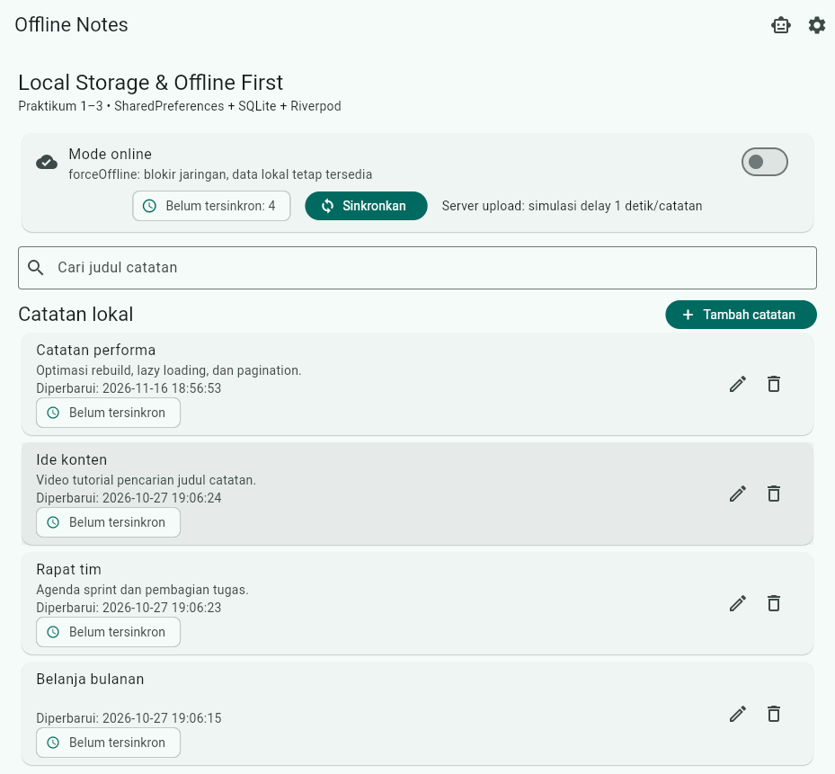
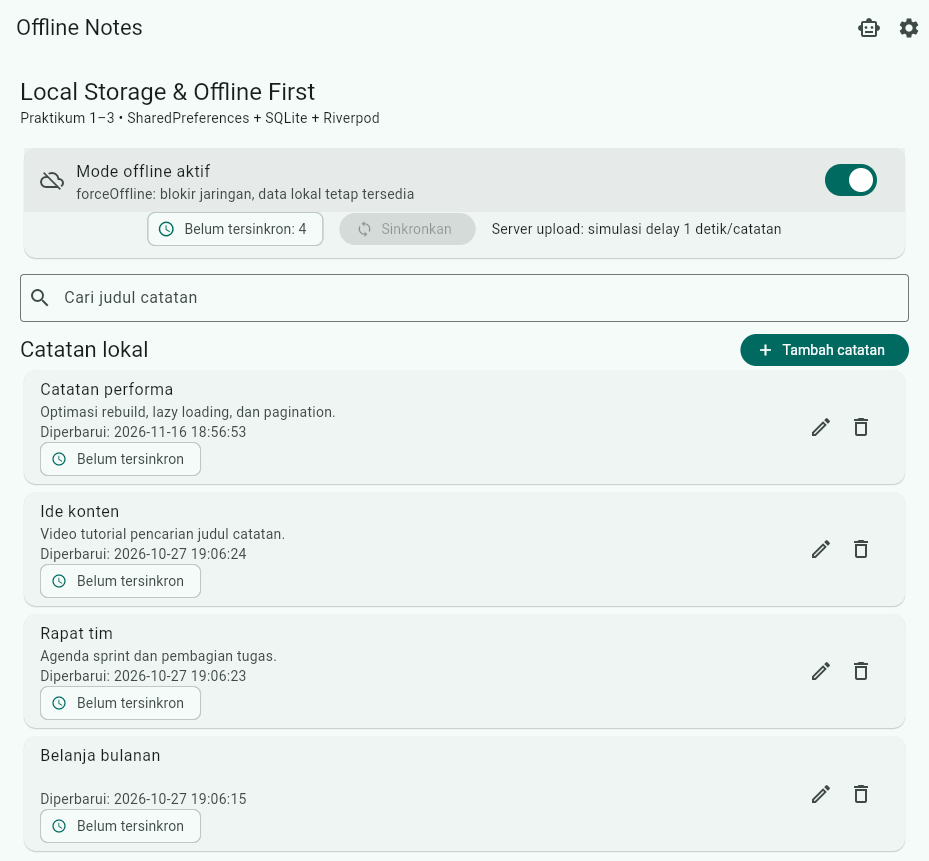
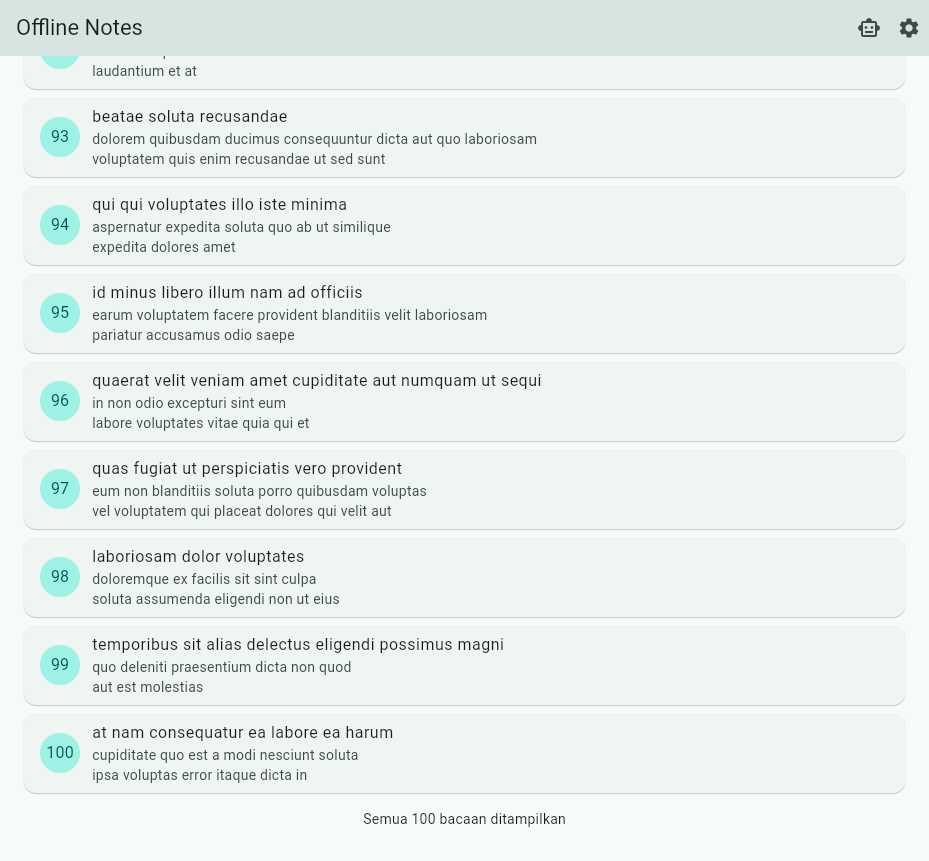

# Laporan Jobsheet Minggu 11

## Optimasi Performa

**Mata kuliah:** Pemrograman Mobile
**Nama:** Raditya Riefki
**NIM:** 244107020204
**Kelas:** TI-3E
**Tanggal:** 9 November 2026

Project kerja: kode aplikasi di folder ini (lihat [`lib/`](lib)), salinan
project Minggu 10 ([`10-week-10-ai-feature-integration`](../10-week-10-ai-feature-integration))
yang dioptimasi performanya. Week 11 tidak menambah fitur baru — kecuali
pagination infinite scroll yang merupakan bagian dari teknik optimasi.

## Ringkasan optimasi

| # | Teknik codelab | Implementasi | Dampak terukur |
|---|---|---|---|
| 1 | Ekstraksi widget + Riverpod `select` | Kartu offline → [`offline_card.dart`](lib/features/notes/presentation/widgets/offline_card.dart), header bacaan → `PostsHeader` | Rebuild per toggle offline: halaman 1 → **0**, tile catatan 1 → **0** |
| 2 | Provider steril dari watch berlebih | `PostsNotifier.build()` mem-`read` (bukan watch) `forceOfflineProvider` | Toggle offline tidak lagi reload cache SQLite |
| 3 | Lazy loading | `CustomScrollView` + `SliverList` (builder) menggantikan `ListView(children:)` + `Column(map)` | Hanya item terlihat yang dibangun |
| 4 | Pagination infinite scroll | `postsPaginationProvider` (10/halaman) + scroll listener + auto-load saat konten muat | Pengguna bisa menjelajah seluruh 100 bacaan cache, bukan potongan 5 |
| 5 | `RepaintBoundary` + const | `NoteTile` & `PostTile` | Paint tile terisolasi saat scroll |
| 6 | Perbaikan kualitas | `refreshErrorProvider` reaktif; trailing pagination statis | Error refresh tampil segera; tanpa animasi tak berujung di luar layar |

Bukti before/after lengkap: [`docs/performance-report.md`](docs/performance-report.md)
dan temuan di [`docs/performance-findings.md`](docs/performance-findings.md).

## Metode: bukti terukur, bukan placebo

Instrumentasi [`lib/core/rebuild_stats.dart`](lib/core/rebuild_stats.dart)
(assert-only, nol biaya di release) menghitung jumlah build per widget.
Widget test [`test/rebuild_perf_test.dart`](test/rebuild_perf_test.dart)
mengukur delta rebuild skenario "toggle mode offline":

**Baseline (sebelum optimasi):**

```text
REBUILD_DELTAS_OFFLINE_TOGGLE={NotesPage: 1, NoteTile: 1, PostsSection: 1}
```

**Setelah optimasi:**

```text
REBUILD_DELTAS_OFFLINE_TOGGLE_AFTER={NotesPage: 0, NoteTile: 0, PostTile: 0}
```

Satu toggle yang tadinya me-rebuild semuanya kini hanya me-rebuild dua widget
kecil yang memang menampilkan status offline (`OfflineCard` dan `PostsHeader`).

Profiling Flame Chart DevTools (`flutter run --profile` → Record →
`before-profile.png` / `after-profile.png`) didokumentasikan sebagai prosedur
manual di [`docs/performance-report.md`](docs/performance-report.md#7-prosedur-profiling-manual-devtools);
metrik rebuild otomatis di atas adalah penyebab jank #1 sesuai codelab dan
terverifikasi penuh oleh test.

## Status jobsheet

| Aspek | Status | Bukti |
|---|---|---|
| Minimal 3 optimasi diterapkan | Lulus | 6 optimasi (tabel di atas) |
| Temuan profiling ≥3 | Lulus | [`docs/performance-findings.md`](docs/performance-findings.md) (5 temuan + 4 kandidat dievaluasi) |
| Baseline metrics | Lulus | Delta rebuild baseline terukur via test |
| Optimasi + alasan pemilihan | Lulus | [`docs/performance-report.md`](docs/performance-report.md) |
| Hasil verifikasi (metrics after) | Lulus | Delta 0 untuk halaman dan tile |
| `flutter analyze` + `flutter test` bersih | Lulus | `No issues found!`, 44 test hijau stabil 3x |
| Push `11-week-11-performance-optimization/` | Lulus | `lib/`, `docs/`, `README.md`, `screenshots/` |
| 1 saran AI ditolak beralasan | Lulus | `CachedNetworkImage` ditolak (tidak ada gambar) — [`docs/ai-log.md`](docs/ai-log.md) |
| Tidak menempel secret | Lulus | Konteks hanya kode + struktur folder |

## Stack teknologi

| Bagian | Teknologi |
|---|---|
| Framework | Flutter 3.47.1 / Dart 3.13.1 |
| State management | Riverpod 3.4.3 |
| Routing | GoRouter 18.0.2 |
| Penyimpanan | SQLite (`sqflite`, `sqflite_common_ffi`) + SharedPreferences |
| Jaringan | Dio 5.11.1 (cache-first sejak Minggu 7) |
| AI | Gemini `generateContent` (fitur Minggu 10, tidak berubah) |
| Instrumentasi | `RebuildStats` assert-only (buatan sendiri, tanpa dependensi) |

## Cara menjalankan

```bash
cd 11-week-11-performance-optimization
flutter pub get
flutter run -d chrome
```

Skenario uji manual:

1. Tambah beberapa catatan, toggle mode offline — hanya kartu offline yang
   berubah, daftar tidak "berkedip" rebuild.
2. Scroll daftar bacaan ke bawah — halaman berikutnya dimuat otomatis
   (10 per halaman) hingga "Semua N bacaan ditampilkan".
3. Refresh bacaan saat jaringan diblokir — pesan "Jaringan gagal..." tampil
   segera dan cache tetap tersedia.

Pemeriksaan mesin:

```bash
flutter analyze
dart format --output=none --set-exit-if-changed lib test
flutter test
```

## Hasil pemeriksaan mesin

```text
flutter analyze
No issues found! (ran in 4.3s)

dart format --output=none --set-exit-if-changed lib test
Formatted 59 files (0 changed) in 0.20 seconds.
format_exit=0

flutter test (3x beruntun)
00:04 +44: All tests passed!
00:04 +44: All tests passed!
00:04 +44: All tests passed!
```

44 test = 42 test lama Minggu 10 (semua tetap hijau tanpa mengubah asersi)
+ 2 test performa baru (delta rebuild & pagination).

## Alur AI-assisted development

```text
Prompt -> Generate (usulan optimasi) -> Verify -> Measure -> Refactor -> Explain
```

- **Generate:** AI mengusulkan 6 optimasi.
- **Verify:** 1 usulan ditolak (CachedNetworkImage — tidak ada gambar);
  instrumentasi dibuat **sebelum** refactor agar baseline jujur.
- **Measure:** baseline `{NotesPage: 1, NoteTile: 1, PostsSection: 1}`;
  after `{NotesPage: 0, NoteTile: 0, PostTile: 0}`.
- **Refactor:** ekstraksi widget, sliver lazy, pagination, RepaintBoundary,
  provider steril, error reaktif.
- **Explain:** keputusan dan trade-off di refleksi tanpa membuka AI.

Detail prompt, usulan awal, temuan saat verifikasi, dan tabel keputusan ada
di [`docs/ai-log.md`](docs/ai-log.md).

## Temuan utama

1. **Rebuild berlebih (blocker):** watch `forceOfflineProvider` di root
   halaman membuat satu toggle me-rebuild semuanya — dibuktikan delta
   baseline, diperbaiki dengan ekstraksi widget.
2. **Reload cache per toggle (blocker):** `PostsNotifier.build()` watch
   `forceOfflineProvider`; setiap toggle membaca ulang SQLite — dibuktikan
   dari kode, diperbaiki dengan `read`.
3. **Tidak ada lazy loading/pagination (blocker):** `Column(map)` +
   `.take(5)` statis — diganti sliver lazy + infinite scroll.
4. **Error refresh tidak reaktif:** field biasa → `refreshErrorProvider`.
5. **Animasi tak berujung di luar layar:** trailing spinner ter-build di
   cacheExtent SliverList (bukti `pumpAndSettle timed out`) — diganti teks
   statis.

## Tabel temuan AI vs keputusan

| # | Usulan AI | Level | Keputusan | Alasan |
|---|---|---|---|---|
| 1 | `CachedNetworkImage` untuk gambar | Saran | Ditolak | Tidak ada gambar di aplikasi; optimasi premature. |
| 2 | Hapus watch `forceOffline` di provider posts | Blocker | Diterima, diperbaiki | Toggle memicu reload cache; dibuktikan test. |
| 3 | `select` untuk chip dirty & tombol sync | Saran | Diterima, diperbaiki | Rebuild lokal di `offline_card.dart`. |
| 4 | Trailing pagination spinner (codelab) | Saran | Ditolak (statis) | Animasi tak berujung di cacheExtent; bukti test timeout. |
| 5 | Auto-load saat konten muat | Blocker | Diterima, diperbaiki | Tanpa itu daftar pendek tak pernah memuat halaman berikut. |
| 6 | Instrumentasi sebelum refactor | Blocker (proses) | Diterima | Baseline harus diambil sebelum kode berubah agar jujur. |

## Screenshot

| Skenario | Screenshot |
|---|---|
| Halaman utama + pagination bacaan |  |
| Toggle offline (hanya kartu berubah) |  |
| Ujung daftar bacaan (semua termuat) |  |

Screenshot diambil dari build web nyata.

## Struktur folder Week 11

```text
11-week-11-performance-optimization/
├── README.md
├── lib/
│   ├── core/rebuild_stats.dart
│   └── features/
│       ├── notes/presentation/
│       │   ├── pages/notes_page.dart          (CustomScrollView + pagination)
│       │   └── widgets/offline_card.dart      (ekstraksi + select)
│       └── posts/
│           ├── presentation/widgets/posts_section.dart (PostsHeader + PostTile)
│           └── presentation/providers/posts_providers.dart (pagination + error reaktif)
├── test/
│   └── rebuild_perf_test.dart                 (metrik before/after + pagination)
├── docs/
│   ├── performance-findings.md
│   ├── performance-report.md
│   └── ai-log.md
└── screenshots/
```

## Refleksi

- **Optimasi mana yang memberi dampak terbesar dan mengapa?** Ekstraksi
  kartu offline + mensterilkan provider dari watch berlebih. Keduanya
  mengubah perilaku paling sering dijalankan (toggle offline) dari
  "rebuild seluruh halaman + reload SQLite" menjadi "dua widget kecil saja".
  Dampaknya terukur: delta 1 → 0 pada halaman dan tile.
- **Bagaimana memverifikasi bukan placebo?** Dengan metrik, bukan perasaan:
  instrumentasi hitung rebuild dipasang dan baseline diambil **sebelum**
  refactor, lalu test yang sama dijalankan setelah refactor. Selisihnya
  di-assert (delta == 0) sehingga regresi di masa depan akan ditangkap test.
- **Trade-off apa yang dihadapi?** Toggle ke online tidak lagi auto-refresh
  API di background (kini lewat tombol refresh) — perilaku lama memang nyaman,
  tetapi itu penyebab reload cache; trailing spinner codelab diganti teks
  statis karena animasi tak berujung di luar layar; dan refactor
  `CustomScrollView` menyentuh halaman utama — risikonya dilindungi 44 test
  yang semuanya hijau tanpa mengubah asersi lama.
- **Kapan optimasi premature sebaiknya dihindari?** Ketika tidak ada bukti
  bottleneck: usulan `CachedNetworkImage` ditolak karena aplikasi tidak
  menampilkan gambar, dan migrasi Hive ditolak karena cache SQLite sudah
  cukup. Optimasi dibenarkan hanya setelah ada angka (delta rebuild, frame
  time) yang menunjukkan masalah.

## Referensi

- [Jobsheet Minggu 11](https://jti-polinema.github.io/flutter-codelab/11-minggu-11-performance-optimization/index.html)
- [Flutter DevTools Overview](https://docs.flutter.dev/tools/devtools/overview)
- [Flutter UI Performance](https://docs.flutter.dev/perf/rendering/ui-performance)
- [`docs/performance-report.md`](docs/performance-report.md) — baseline, optimasi, verifikasi.
- [`docs/ai-log.md`](docs/ai-log.md) — prompt, usulan AI, keputusan.